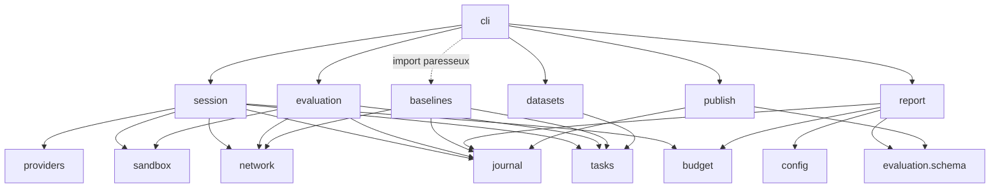
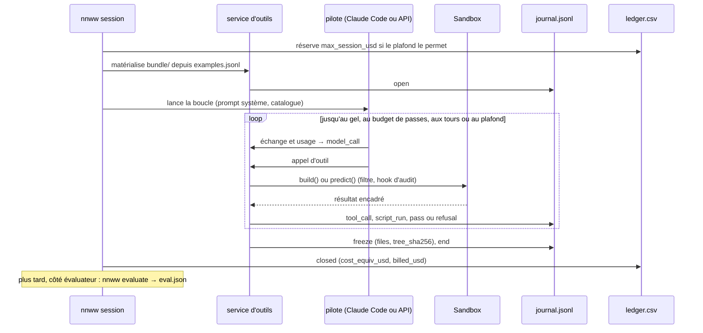
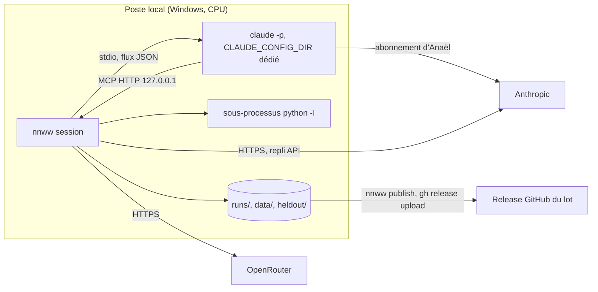

# Architecture Spine — nn-weight-writing

## Design Paradigm

**Pipeline de commandes sur artefacts immuables.** Chaque étape est une sous-commande de `nnww` qui lit des fichiers et en écrit de nouveaux, sans jamais modifier ceux d'une étape précédente : générer un jeu, tenir une séance, évaluer, entraîner un témoin, agréger, publier.

**Harnais en ports et adaptateurs.** Le cœur de séance est un **service d'outils** : il tient l'état de la séance (passes, production, gel) et seul il écrit le journal. Deux **pilotes** mènent la boucle avec le modèle, et un port `Sandbox` exécute le code de l'agent.

| Pilote | Qui mène la boucle | Usage |
| --- | --- | --- |
| `ClaudeCodeDriver` | `claude -p` ; outils servis par un serveur MCP HTTP local, dans le processus `nnww session` | Modèles Anthropic, par l'abonnement d'Anaël (défaut) |
| `ApiLoopDriver` | le harnais, par le port `ModelProvider` | MiMo via OpenRouter ; API Anthropic en repli |

Le dépôt est coupé par une **frontière de confiance** : le côté séance ne voit que les exemples non annotés ; le côté évaluateur seul lit les étiquettes et les jeux réservés.

| Côté | Paquets (`src/nn_weight_writing/`) |
| --- | --- |
| Séance | `session/` (service d'outils, pilotes), `providers/`, `sandbox/`, `network/`, `journal/`, `tasks/` (description, encodeurs, lecteur d'exemples) |
| Évaluateur | `datasets/`, `evaluation/`, `baselines/` (PyTorch), `report/`, `publish/` |
| Commun | `cli.py`, `config.py`, `budget/` (registre) |

## Invariants & Rules



Les flèches sont les seules dépendances permises. `cli` n'importe `baselines` (donc `torch`) qu'à l'intérieur du gestionnaire de `nnww train`. `evaluation.schema` désigne ce seul module (dataclasses et constantes de noms de fichiers), pas le reste d'`evaluation` (amendement 1-14 : producteurs et lecteurs importent le même module). `report → config` sert au plafond du lot (`load_protocol`) ; `publish` ne lit pas la configuration, `cli` lui passe `r_republish` et `r_tasks`.

### AD-1 — Frontière de confiance vérifiée par un test

- **Binds:** CAP-2, tous les paquets
- **Prevents:** un outil de séance qui importe un module capable de lire des étiquettes, `heldout/` ou un gradient.
- **Rule:** un test parcourt l'AST de `session/`, `providers/`, `sandbox/`, `network/`, `journal/`, `tasks/` et `budget/`. Il échoue sur tout import de `torch`, `jax`, `nn_weight_writing.evaluation`, `.baselines`, `.report`, `.datasets` ou `.publish`. Aucun module du côté séance ne connaît le nom de fichier `labels.jsonl` ni le dossier `heldout/` : la configuration d'une séance n'en contient aucun chemin.

### AD-2 — Le modèle ne voit que le paquet de séance

- **Binds:** CAP-2, CAP-9, CAP-11
- **Prevents:** une séance qui lit les données à la source et y trouve étiquettes ou types tenus à l'écart.
- **Rule:** `nnww session` matérialise d'abord `runs/<lot>/<session_id>/bundle/` à partir du seul `examples.jsonl` (AD-16), lu par `tasks.io.read_examples`. Le paquet contient :
  - la description de tâche, avec le **vocabulaire fermé des types d'erreur visibles** (identifiants et descriptions) ;
  - les exemples non annotés ;
  - l'identifiant de l'encodeur.

  Aucun exemple n'y porte d'étiquette ni de type. Pour S-réservé, le vocabulaire ne contient que les 10 types connus. Les outils ne lisent que ce dossier.

### AD-3 — Un seul format de réseau

- **Binds:** CAP-4, CAP-5, CAP-7, CAP-12, CAP-14
- **Prevents:** A-littéral, A-programme et les témoins qui produisent des formats différents ; une passe NumPy et un réentraînement PyTorch qui lisent la même architecture différemment.
- **Rule:** un réseau est un couple :
  - `manifest.json`, conforme au JSON Schema `network/manifest.schema.json` : couches, activations, `encoder` et, après le gel, `blocks` ;
  - `weights.npz`, avec les clés `L{i}.W` et `L{i}.b` en `float32`.

  Le manifeste s'écrit par l'outil `declare_network` (AD-15), jamais par un script. Les poids viennent de `write_weights` (A-littéral), de `build()` (A-programme) ou d'un entraînement (C, E, F). Tout chargement passe par `network.load`, qui appelle `np.load(..., allow_pickle=False)` et valide le manifeste. Un type de couche n'existe dans le registre `network.layers` qu'avec une implémentation NumPy, une implémentation PyTorch dans `baselines/` et un test de parité entre les deux.

### AD-4 — L'encodage des entrées appartient à la tâche

- **Binds:** CAP-5, CAP-6, CAP-7, CAP-9, CAP-11
- **Prevents:** un écart A − C qui viendrait de deux représentations d'entrée plutôt que des poids.
- **Rule:** chaque tâche de `tasks/` expose `encode(raw) -> ndarray[float32]` et `decode(outputs) -> label`, purs et fixes, partagés par A, C et E, sous l'identifiant `{task}.{encoder}@{version}`. F utilise un second encodeur, `encode_prepared`, déclaré par la même tâche. B reçoit la chaîne brute. L'agent n'écrit jamais d'encodeur.
- **Amendement (2026-11-06, validé par Anaël, O4 de la story 1-9) :** une famille de tâches au même encodage déclare `{famille}.{encodeur}@{version}` (ex. `legal.chars@1`, commun à `legal_s`, `legal_s_reserved` et R). La tâche reste dans `dataset.json`, et l'évaluation la contrôle : elle lit la tâche de la séance (premier événement `open` du journal) ou du témoin (`run.json`), et refuse un réseau dont la tâche diffère de celle du jeu évalué. L'évaluation croisée journalisée (réseau de S évalué sur S-réservé ou R) est laissée à 1-14.

### AD-5 — Un bac à sable unique pour le code de l'agent

- **Binds:** CAP-2, CAP-5, CAP-6 (stories 1-5, 1-7, 1-10)
- **Prevents:** un script qui lit des fichiers ou le réseau, ou qui désarme l'isolement par introspection ; des règles B qui lisent les étiquettes ou accumulent des statistiques d'un exemple à l'autre ; deux mécanismes d'isolement qui divergent entre A et B.
- **Rule:** tout code écrit par l'agent passe par `sandbox.run(code, profile, payload) -> result`, et rien d'autre ne l'exécute, ni en séance ni en évaluation. Les quatre couches sont toutes obligatoires.
  1. **Filtre statique** à la soumission. Imports autorisés selon le profil : `A` = `numpy` seul ; `B` = `re`, `datetime`, `math`, `unicodedata`. Le code est refusé s'il contient :
     - les noms `open`, `exec`, `eval`, `compile`, `__import__`, `globals`, `locals`, `vars`, `getattr`, `setattr`, `delattr`, `breakpoint`, `input`, `help` ;
     - tout attribut qui commence par `_`, `f_`, `gi_`, `tb_`, `co_`, `cr_` ou `ag_` ;
     - les attributs `format`, `format_map`, `ma`, `f2py`, `ctypeslib`, `lib`, `testing`, `load`, `save`, `savez`, `savez_compressed`, `savetxt`, `fromfile`, `tofile`, `memmap`, `loadtxt`, `genfromtxt` et `DataSource` ;
     - les instructions `global` et `nonlocal` ;
     - les fonctions d'ajustement de AD-19.

     Un `import os` vers un module déjà chargé ne lève aucun événement d'audit (vérifié sous Python 3.14.6) : ce filtre n'est pas facultatif.
  2. **Sous-processus** `sys.executable -I`, avec un répertoire courant temporaire vide, un environnement réduit à `SYSTEMROOT` et `PATH` (aucune clé d'API) et un délai maximal. L'amorçage :
     1. précharge les modules du profil, dont `numpy.linalg`, `numpy.random` et `numpy.fft` ;
     2. compile le code ;
     3. pose un `sys.addaudithook` défini en fermeture, sans drapeau modifiable, qui refuse les événements `open` et `import`, `sys._getframe`, `sys._current_frames`, ainsi que les préfixes `os.`, `socket.`, `subprocess.`, `ctypes.`, `_winapi.`, `winreg.`, `msvcrt.` et `shutil.` ;
     4. exécute le code dans un espace de noms neuf, avec des builtins réduits.
  3. **Entrées et sorties encadrées.** Pendant l'exécution, `sys.stdout` est redirigé vers un tampon renvoyé comme `log`. Le résultat sort seul, sur le descripteur d'origine, en une trame JSON.
     - Profil A : le script définit `build() -> dict[str, ndarray]`, et l'amorçage sérialise ce dictionnaire.
     - Profil B : le code définit `predict(raw: str) -> label`. Il est réexécuté dans un espace de noms neuf **pour chaque exemple**.
  4. **Corpus d'évasions** en test de non-régression : remontée des cadres d'un générateur, parcours de `np` (`np.ma.core.builtins`, `np.f2py.os`, `np.ctypeslib`), `string.Formatter`, `np.load(allow_pickle=True)`, `import os` déjà chargé. Chaque cas connu doit échouer.
- **Modèle de menace :** le bac à sable bloque les raccourcis d'un agent qui optimise honnêtement, pas une évasion malveillante. Ce qu'il ne peut pas empêcher relève de l'audit de AD-19.

### AD-6 — Passe : décompte avant exécution, jamais de score

- **Binds:** CAP-2, CAP-8, CAP-14
- **Prevents:** des budgets comptés différemment entre A-littéral, A-programme et B, ou selon la taille, ce qui ôterait son sens au signal (a) du critère de limite.
- **Rule :**
  - **Ce qui compte.** `run_on_examples` est la seule passe. Elle exécute la production courante sur tous les exemples du paquet. Le service l'incrémente avant d'exécuter, même si la production se révèle invalide. `submit_script` et `submit_rules` ne sont pas des passes, mais chacun écrit un événement `script_run`.
  - **Ce qu'elle renvoie.** Réseau : vecteur de sortie et label décodé par exemple. B : label par exemple. Jamais de score : le paquet n'a pas d'étiquettes.
  - **Après la dernière passe.** Toute passe est refusée (`pass_budget_exhausted`) et seul `freeze` reste permis. La séance se termine :
    - par le gel ;
    - par `pass_budget`, si l'agent rend la main sans geler ;
    - par `turn_limit`, au plafond de tours.
  - **Configuration.** Le budget (20) et le plafond de tours sont dans `config/protocol.toml` ; le budget est copié dans l'événement `open`. Le recalibrage unique après le jouet modifie ce fichier et se consigne comme décision.

### AD-7 — Le journal de séance, source unique

- **Binds:** CAP-2, CAP-3, CAP-5, CAP-12, CAP-13
- **Prevents:** des mesures ou des coûts saisis à la main ou tirés d'une autre source ; deux écrivains d'un même journal ; un producteur et un consommateur qui lisent le même événement différemment.
- **Rule :**
  - **Format.** Un fichier `journal.jsonl` par séance, en ajout seul, écrit par le seul service d'outils. Les pilotes et les adaptateurs lui transmettent des données, ils n'écrivent pas eux-mêmes.
  - **Schéma.** Les types d'événement sont des dataclasses de `journal/schema.py`, importées par tous les lecteurs. Chaque ligne porte `schema_version`, `seq` (croissant à partir de 0), `ts` et `type`.

  | `type` | Champs obligatoires |
  | --- | --- |
  | `open` | tâche, jeu et son sha256, méthode, modèle, pilote, fournisseur, tentative, graine, budget de passes, `protocol_sha256`, `system_prompt_sha256`, paramètres d'échantillonnage et effort |
  | `model_call` | tokens d'entrée, de sortie, de lecture et d'écriture du cache, `cost_equiv_usd`, `billed_usd`, `provider_cost` (si fourni), durée, contenu de l'échange |
  | `tool_call` | outil, arguments, résultat ou code de refus |
  | `pass` | numéro, passes restantes, `valid`, sorties |
  | `script_run` | sha256 du code, `ok`, `log`, drapeaux d'audit de AD-19, durée |
  | `refusal` | code (énumération de `session/refusals.py`), détail |
  | `freeze` | `files` (nom → sha256), `tree_sha256`, `valid`, `blocks`, `size_nominal` (paramètres), `size_effective` (octets du script ; octets zlib niveau 9 des poids `float32` concaténés dans l'ordre des clés) |
  | `end` | motif ∈ {`frozen`, `pass_budget`, `money_budget`, `turn_limit`, `error`}, totaux de tokens, de coût et de durée |

  - **Secrets.** Aucune clé ni aucun en-tête HTTP n'y entre (test de recherche des préfixes de clé).
  - **Tableau.** Le tableau de CAP-12 se régénère depuis les journaux, les `run.json` (AD-17) et les `eval.json`, sans autre entrée.

### AD-8 — Gel et empreinte

- **Binds:** CAP-4, CAP-5, CAP-12
- **Prevents:** un manifeste, des blocs ou un script modifiés après la séance sans détection ; une lisibilité impossible à mesurer faute de blocs complets.
- **Rule :**
  - **Contenu.** `freeze` clôt la séance et écrit `frozen/` : `manifest.json` (avec les blocs), `weights.npz` et, pour A-programme, `script.py` ; pour B, `rules.py`.
  - **Écriture.** Chaque fichier est écrit en temporaire puis renommé. L'événement `freeze` porte le sha256 de chaque fichier et `tree_sha256`, le sha256 des lignes `nom sha256` triées.
  - **Blocs.** Pour A, le gel est refusé si les blocs ne forment pas une partition des unités cachées, ou si un bloc ne porte pas une règle en texte et des identifiants pris dans le vocabulaire de AD-2.
  - **Validité.** `valid` indique si la production se charge et s'exécute sans erreur sur les exemples. Ce contrôle ne consomme pas de passe, et rien n'en est renvoyé à l'agent.
  - Rien n'écrit plus dans `frozen/` ensuite.

### AD-9 — Évaluation hors séance

- **Binds:** CAP-4, CAP-12
- **Prevents:** une évaluation qui écrit dans un journal ; des étiquettes qui fuient vers le code de l'agent ; un artefact évalué sans gel.
- **Rule :**
  - **Entrée.** `nnww evaluate <run_dir>` vit côté évaluateur. Elle refuse un dossier sans enregistrement de gel : l'événement `freeze` d'une séance, ou le `run.json` d'un témoin.
  - **Vérification.** Elle recalcule les sha256 et `tree_sha256`, et refuse toute divergence.
  - **Exécution.** Le réseau passe par `network.load` et la passe NumPy en processus. B passe par `sandbox.run` avec les seules entrées brutes ; les étiquettes restent dans l'évaluateur.
  - **Sortie.** Elle écrit `eval.json` à côté, avec des mesures agrégées, par type et par bloc éteint, et aucun exemple réservé.
  - **Déterminisme.** Deux évaluations donnent le même `eval.json`, au champ `ts` près.

### AD-10 — Port fournisseur normalisé, pour le pilote API

- **Binds:** CAP-3 (story 1-6), CAP-14 (vision)
- **Prevents:** un service d'outils qui branche selon le fournisseur.
- **Rule :**
  - **Port.** `ModelProvider.complete(ChatRequest) -> ChatResponse`, sur les types de `providers/types.py` : messages à parties de contenu (texte, image au lot 2), outils en JSON Schema, appels d'outils, `Usage(input, output, cache_read, cache_write, provider_cost | None)`.
  - **Adaptateurs.**
    - `openrouter` : API chat completions compatible OpenAI, SDK `openai`, `base_url`. Il traduit `cached_tokens` et `cache_write_tokens`.
    - `anthropic` : SDK `anthropic`, avec cache de prompt. C'est le repli du pilote Claude Code.
    - `fake` : réponses scriptées pour les tests.
  - **Erreurs.** Les nouvelles tentatives sur erreur transitoire restent dans l'adaptateur, et chaque appel facturé remonte son usage.
  - **À vérifier.** L'API chat completions pour MiMo reste à confirmer par la sonde 1-2, qui dira aussi si l'endpoint OpenRouter compatible Anthropic vaut mieux.

### AD-11 — Coût et registre budgétaire

- **Binds:** CAP-3 (story 1-6), CAP-13
- **Prevents:** deux formules de coût ; plusieurs écrivains du registre ; des séances ouvertes en parallèle invisibles pour le plafond.
- **Rule :**
  - **Deux coûts par appel.**
    - `cost_equiv_usd` = tokens × `config/pricing.toml` (tarifs datés, par modèle), quel que soit le pilote ; il sert au rapport et à la comparaison entre modèles.
    - `billed_usd` = ce qui est réellement facturé : 0 par l'abonnement, `cost_equiv_usd` par l'API Anthropic, le calcul tarifaire par OpenRouter, dont le `usage.cost` est journalisé en contrôle.
  - **Plafonds.** Seul `billed_usd` s'impute sur les plafonds du lot et du projet (`config/protocol.toml`). La porte de coût se calcule elle aussi sur `billed_usd` : elle ne joue pas sur une séance par abonnement.
  - **Registre.** `budget/ledger.csv` est commité, sans en-tête, avec `merge=union` dans `.gitattributes`. Il est écrit seulement par `budget.ledger.append` :
    1. une ligne `reserved` à l'ouverture (`max_session_usd` facturable) ;
    2. une ligne `closed` à la fin (coûts réels), même en cas d'erreur ;
    3. les lectures dédoublonnent par `(session_id, status)`.
  - **Ouverture.** Une séance s'ouvre seulement si facturé + réservations ouvertes + `max_session_usd` ≤ plafond. Sinon elle est refusée, avec une demande de décision à Anaël.
  - **En cours de séance.** Elle s'arrête (`money_budget`) dès que son `billed_usd` atteint `max_session_usd`.
  - **Réconciliation.** `nnww ledger reconcile` clôt les réservations orphelines depuis les journaux.
  - **Hors registre.** C, E et F n'y écrivent pas. La sonde 1-2 y écrit une ligne `closed`.

### AD-12 — Emplacements et identifiants des artefacts

- **Binds:** CAP-4, CAP-9, CAP-12, CAP-13
- **Prevents:** des poids ou des jeux commités ; des étapes qui cherchent les artefacts à des chemins différents.
- **Rule :**
  - **Dossiers.**
    - Séances : `runs/<lot>/<session_id>/{bundle/, journal.jsonl, frozen/, eval.json}`.
    - Témoins : `runs/<lot>/train/<run_id>/{run.json, frozen/, eval.json}`.
    - Jeux : `data/<task>/<dataset>/` et `heldout/<task>/<dataset>/`.

    `runs/`, `data/`, `heldout/` et `models/` sont ignorés par git.
  - **Identifiants.**
    - `session_id` = `{task}-{method}-{model_slug}-t{n}-{YYYYMMDDTHHMMSSZ}`, où `model_slug` ne garde que `[a-z0-9.-]`.
    - `run_id` = `{task}-{baseline}-n{N}-s{seed}`.

### AD-13 — PyTorch confiné aux témoins `[ADOPTED]`

- **Binds:** CAP-7, CAP-14, CAP-15
- **Prevents:** un gradient à portée des outils de séance.
- **Rule :**
  - `torch` vit dans le groupe de dépendances `train` (`uv add --group train`), importé seulement par `baselines/`, par import paresseux depuis `cli`. Le harnais tourne avec NumPy seul.
  - Un réseau écrit se charge dans PyTorch par le registre de couches de AD-3.
  - Tracr (lot 3) reste hors de ce groupe, dans un environnement à décider en 3-1.

### AD-14 — Pilote Claude Code, par abonnement

- **Binds:** CAP-3, CAP-5, CAP-6 (story 1-6)
- **Prevents:** une séance Claude dont le contexte contient autre chose que la description de tâche (`CLAUDE.md` global, mémoire, plugins, outils intégrés) ; un second écrivain du journal ; un protocole différent entre Claude et MiMo.
- **Rule :** `ClaudeCodeDriver` lance `claude -p` depuis un répertoire courant temporaire vide, avec :
  - `CLAUDE_CONFIG_DIR` pointant vers un dossier dédié (`~/.nnww/claude-config`, connexion unique d'Anaël, aucun réglage, aucun plugin) ;
  - `--tools ""`, `--strict-mcp-config` et `--mcp-config` vers le serveur MCP HTTP que `nnww session` sert sur `127.0.0.1` depuis le service d'outils ;
  - `--system-prompt-file`, le même fichier que l'`ApiLoopDriver` ;
  - `--model`, `--effort` et `--max-turns`, explicites et journalisés ;
  - `--no-session-persistence`, `--output-format stream-json --verbose`.

  Le pilote lit le flux et transmet au service d'outils, pour journalisation, les échanges et l'usage par message. Un test de contamination exige que la première requête de la séance ne contienne que le prompt système et la description de tâche. Une coupure par limite d'usage termine la séance en `error`, avec la cause journalisée ; la tentative est rejouée, jamais reprise.

### AD-15 — Catalogue d'outils unique

- **Binds:** CAP-2, CAP-5, CAP-6
- **Prevents:** deux pilotes qui exposent des outils différents ; un A-littéral à ~10⁴ poids impossible à écrire en une réponse.
- **Rule :** un registre unique, `session/tools.py` (nom, JSON Schema, méthodes autorisées), sert à la fois l'API et le MCP, sous les mêmes noms.

  | Outil | Méthodes | Effet |
  | --- | --- | --- |
  | `declare_network(manifest)` | A | Fixe l'architecture (AD-3) ; rejouable avant le premier poids |
  | `write_weights(layer, param, row_start, rows)` | A-littéral | Écrit une tranche de lignes ; l'agent peut écrire par morceaux |
  | `submit_script(code)` | A-programme | Filtre et `build()` dans le bac à sable ; `script_run` |
  | `submit_rules(code)` | B | Filtre statique ; `script_run` |
  | `run_on_examples()` | toutes | La passe (AD-6) |
  | `freeze(blocks?)` | toutes | Le gel (AD-8) |

  Un test vérifie que, pour un même `(task, method)`, le prompt système, la description, le catalogue et le budget de passes sont identiques quel que soit le modèle et le pilote.

### AD-16 — Jeux : exemples et étiquettes séparés

- **Binds:** CAP-8, CAP-9, CAP-11, CAP-14
- **Prevents:** un lecteur de séance qui ouvre un fichier étiqueté ; deux formats de jeu entre générateurs ; un exemple du paquet qui réapparaît dans le jeu réservé.
- **Rule :**
  - **Fichiers.** `nnww datagen` écrit, pour chaque jeu, `examples.jsonl` (`id`, `raw`), `labels.jsonl` (`id`, `label`, `type_id`) et `dataset.json` (générateur, version, graine, sha256 des deux fichiers).
  - **Lecteurs.** Le lecteur d'exemples vit dans `tasks/io.py`, celui des étiquettes dans `evaluation/`.
  - **Recouvrement.** Un test de `datasets/` vérifie qu'aucun `id` ni aucun `raw` n'est commun au jeu de séance et au jeu réservé.
  - **Normaliseur de R.** Il est commun aux vraies et aux fausses références et s'applique avant l'écriture de `raw`.

### AD-17 — Témoins C, E et F au format commun

- **Binds:** CAP-7, CAP-12, CAP-14
- **Prevents:** un évaluateur parallèle dans `baselines/` ; des courbes C non comparables entre tâches.
- **Rule :**
  - **Protocole d'entraînement.** `config/train.toml` fixe, par tâche, l'architecture de référence, les N (64, 256, 1 024, 8 192 et plus), les graines, l'optimiseur et les époques.
  - **Sortie.** `nnww train` écrit `frozen/` au format de AD-3, avec l'encodeur `encode` ou `encode_prepared`, et un `run.json` (métadonnées, `files`, `tree_sha256`).
  - **Évaluation.** Elle passe par `nnww evaluate`, comme pour A.
  - **Variantes.**
    - Point « même réseau » : il part du `manifest.json` gelé d'une séance A, poids réinitialisés.
    - E : il part des poids gelés d'une séance A.

### AD-18 — Publication contrôlée

- **Binds:** CAP-13, CAP-14
- **Prevents:** une clé d'API, un exemple réservé ou une référence Judilibre non republiable dans une release.
- **Rule :**
  - **Assemblage.** `nnww publish <lot>` assemble `runs-lot<N>.tar.gz`, par liste blanche : pour une séance `journal.jsonl`, `system_prompt.md`, `frozen/`, `eval.json`, `eval-cross-*.json` ; pour un témoin `run.json`, `frozen/`, `eval*.json`. Elle exclut `bundle/`, `data/` et `heldout/`, que les graines suffisent à régénérer. Archives reproductibles (membres triés, `mtime = 0`, uid et gid nuls, gzip à `mtime = 0`).
  - **Archive de R (R2 du constat 1-3, amendement 1-14 Q1).** Le jeu R ne se régénère pas par graine : si `r_republish = true` et qu'un jeu d'une tâche de `r_tasks` (`config/publish.toml`, `["legal_r"]`) existe sous `data/` ou `heldout/`, `nnww publish` assemble aussi `r-lot<N>.tar.gz` : `examples.jsonl`, `labels.jsonl`, `dataset.json` (daté par `extraction_date`) et `sources.jsonl` de chaque jeu, réservé compris (réévaluation par un tiers). Aucun texte au-delà de la référence normalisée, ni nom. Un lot ultérieur qui voudrait un R réservé le retire de l'archive.
  - **Refus.** Tous les contrôles tournent avant toute écriture, sur chaque fichier de chaque archive ; la commande refuse l'archive :
    - si un fichier contient un motif de clé (`sk-ant-`, `sk-or-`, `Bearer `) ;
    - si un fichier contient la valeur d'une variable de secret de l'environnement ou du `.env` (R6) : `JUDILIBRE_KEY_ID`, `PISTE_CLIENT_ID`, `PISTE_CLIENT_SECRET`, `OPENROUTER_API_KEY`, `ANTHROPIC_API_KEY`, `CLAUDE_CODE_OAUTH_TOKEN` et tout nom en `_KEY`, `_SECRET`, `_TOKEN` ; le message nomme la variable, jamais la valeur ;
    - si un artefact de R est présent sans `r_republish = true` dans `config/publish.toml` (constat 1-3) ;
    - si un `raw` réservé (12 caractères au moins) figure dans l'archive des runs, recherche normalisée (chaînes JSON décodées récursivement, échappements décodés, casse et blancs normalisés) ;
    - si un JSON porte une clé `text`, `zones` ou `text_highlight` (hors bloc de message `{"type": "text"}` dans un journal), si un `raw` porte un motif de nom de partie ou dépasse 160 caractères, si `sources.jsonl` ne tient pas la condition 3, ou si `NOTICE` n'a pas l'attribution, l'URL de la licence et la date d'extraction (condition 2) ;
    - si un chemin passe par `interne/`, `collecte/`, `cache/` ou par la collecte brute de 1-12a (`data/r/collecte/`, `collecte.jsonl`, `pilote.jsonl`).
  - **Sorties publiées hors archive.** `nnww publish --check PATH...` applique les mêmes contrôles au tableau, au fichier de décisions, au rapport, aux notes de release et au billet ; `nnww table` l'appelle sur ce qu'il écrit.
  - **Empreintes.** Elle écrit `SHA256SUMS` (dans chaque archive et à côté des archives). Le rapport cite les `tree_sha256`.

### AD-19 — Interdit statistique : prévention partielle et audit publié

- **Binds:** CAP-2, CAP-5, CAP-6, CAP-13
- **Prevents:** l'illusion que le bac à sable fait respecter seul l'interdit des statistiques. L'agent voit les exemples et peut les recopier en littéraux dans son code.
- **Rule :**
  - **Prévention.** Le filtre de AD-5 refuse :
    - les fonctions d'ajustement : `lstsq`, `svd`, `pinv`, `eig`, `eigh`, `solve`, `inv`, `polyfit`, `cov`, `corrcoef` ;
    - un code dont les littéraux dépassent 8 Ko de chaînes ou 512 nombres.
  - **Audit.** Chaque `script_run` journalise des drapeaux, sans refus :
    - recouvrement de fragments d'au moins 12 caractères entre les littéraux et les exemples du paquet ;
    - boucles itératives sur des tableaux de taille égale au nombre d'exemples.
  - **Publication.** Le rapport publie ces drapeaux par séance. Une séance signalée est relue et jugée, et la décision est consignée avant d'en tirer une conclusion.

## Consistency Conventions

| Concern | Convention |
| --- | --- |
| Langues | Identifiants, clés JSON et noms de fichiers en anglais ; docs, messages de commit et rapports en français. |
| CLI | Un seul point d'entrée `nnww` (argparse), avec les sous-commandes `datagen`, `session`, `evaluate`, `train`, `table`, `ledger`, `publish`. |
| Configuration | TOML sous `config/` : `models.toml` (modèle → pilote, fournisseur, identifiant), `pricing.toml`, `protocol.toml` (passes, tours, tentatives, portes, plafonds), `train.toml`, `publish.toml`. Secrets en variables d'environnement ou dans un `.env` non commité seulement (`ANTHROPIC_API_KEY`, `OPENROUTER_API_KEY`, `JUDILIBRE_KEY_ID`, et `PISTE_CLIENT_ID`, `PISTE_CLIENT_SECRET` pour le repli OAuth : R6 du constat 1-3). |
| Schémas partagés | Événements dans `journal/schema.py` ; manifeste dans `network/manifest.schema.json` ; `eval.json` et `run.json` dans `evaluation/schema.py`. Producteurs et lecteurs importent le même module. |
| Dates et argent | Horodatage UTC ISO 8601 avec `Z` ; montants en dollars, `float` arrondi à 6 décimales. |
| Refus | Codes énumérés dans `session/refusals.py` ; l'outil renvoie `{"refused": "<code>", "detail": "..."}` et le service écrit un événement `refusal` avec le même code. |
| Valeurs numériques | `float32` pour les poids et les entrées encodées ; graines explicites, jamais d'aléa global. |
| Tests | Hors ligne par défaut (fournisseur `fake`, `claude` simulé) ; appels réels marqués `@pytest.mark.live`, désélectionnés par défaut. |
| Versions | SemVer dans `pyproject.toml` et `__init__.py`, tag annoté et release par lot (`AGENTS.md`). |

## Stack

| Name | Version |
| --- | --- |
| Python | 3.14 (3.14.6 en local) |
| uv | 0.13.7 (poste à 0.12.23 ; `uv_build` borné sous 0.13 dans `pyproject.toml`) |
| numpy | 2.5.4 |
| anthropic (SDK) | 2.6.0 |
| openai (SDK, pour OpenRouter) | 3.46.0 |
| mcp (SDK, serveur HTTP du pilote Claude Code) | 2.3.0 |
| Claude Code (CLI) | 2.1.318 |
| torch (groupe `train`, CPU) | 2.15.0 |
| pytest / ruff | 9.2 / 0.17 |

Versions relevées le 2026-11-05 ; `uv add` les résout au moment de la story (`AGENTS.md`).

## Structural Seed





```text
nn-weight-writing/
  config/            # models, pricing, protocol, train, publish (.toml)
  budget/ledger.csv  # registre commité (AD-11)
  src/nn_weight_writing/
    cli.py
    session/         # service d'outils, tools.py, refusals.py, pilotes api/ et claude_code/
    providers/       # types.py, anthropic.py, openrouter.py, fake.py
    sandbox/         # filtre AST, amorçage, exécuteur, corpus d'évasions (tests)
    network/         # manifest.schema.json, couches, passe NumPy, load, sha256
    journal/         # schema.py, écrivain, lecteur
    tasks/           # toy/, legal/, images/ : description, encode, decode, io.py
    budget/          # ledger
    datasets/        # générateurs → data/, heldout/
    evaluation/      # schema.py, vérification d'empreinte, mesures, ablation
    baselines/       # PyTorch : C, E, F
    report/          # tableau CAP-12
    publish/         # archive, contrôles, SHA256SUMS
  tests/
```

## Capability → Architecture Map

| Capability / Area | Lives in | Governed by |
| --- | --- | --- |
| CAP-1 vérifications | `docs/verifications/`, sonde dans `providers/` | AD-10, AD-11, AD-14 |
| CAP-2 harnais de séance | `session/`, `sandbox/`, `journal/` | AD-1, AD-2, AD-5, AD-6, AD-7, AD-15, AD-19 |
| CAP-3 multi-fournisseur et coût | `session/` pilotes, `providers/`, `budget/` | AD-10, AD-11, AD-14 |
| CAP-4 gel et évaluation | `session/` (freeze), `evaluation/` | AD-8, AD-9, AD-12 |
| CAP-5 A-programme, A-littéral | `session/tools.py`, `network/`, `sandbox/` | AD-3, AD-5, AD-8, AD-15, AD-19 |
| CAP-6 témoin B | `sandbox/` profil B, `evaluation/` | AD-5, AD-9, AD-15 |
| CAP-7 témoins C et F | `baselines/` | AD-3, AD-4, AD-13, AD-17 |
| CAP-8 jouet | `tasks/toy/`, `datasets/` | AD-4, AD-6, AD-16 |
| CAP-9 S et S-réservé | `datasets/`, `tasks/legal/` | AD-2, AD-4, AD-16 |
| CAP-10 pré-étude R | `docs/` ; classement d'après `datasets/legal_r/` | AD-16 ; décision de porte dans `config/r_gate.toml` (pas `protocol.toml`, empreinté par séance ; story 1-12, P12) |
| CAP-11 jeu R | `datasets/` (normaliseur commun), `tasks/legal/` | AD-2, AD-4, AD-16, AD-18 |
| CAP-12 mesures | `evaluation/`, `report/` | AD-7, AD-8, AD-9, AD-17 |
| CAP-13 publication | `publish/`, `report/` | AD-7, AD-11, AD-18, AD-19 |
| CAP-14 lot 2 | `tasks/images/`, `providers/` (images), `baselines/` (E) | AD-3, AD-10, AD-13, AD-17 |
| CAP-15 lot 3 | à décider en 3-1 | AD-3, AD-13 |

## Deferred

- **Images dans les pilotes** (lot 2) : `ChatRequest` et le MCP admettent des parties image ; leur encodage se décide en 2-1, d'après le constat 1-2 sur la vision de MiMo.
- **Couches convolutives et attention** : ajoutées au registre de AD-3 par la story qui en a besoin (2-x, 3-x), avec leur test de parité.
- **Limite mémoire du bac à sable** : Windows n'a pas de `resource`, et le délai suffit au lot 1. Un Job Object ne s'ajoute que si un script sature le poste.
- **Environnement de Tracr** (JAX, dm-haiku) : décidé en 3-1.
- **Formules de robustesse et d'énergie estimée** : fixées par la story 1-14 dans `evaluation/`, au format de `evaluation/schema.py`.
- **Hugging Face** : seulement si les assets du lot 2 dépassent quelques centaines de Mo.
- **CI distante** : ruff et pytest hors ligne suffisent tant qu'aucun run autonome parallèle n'est lancé ; une CI de branche s'ajoute avant le premier.
- **Mise à niveau d'uv** (0.13) et de la borne `uv_build` : story `chore` à part, hors des stories du harnais.
